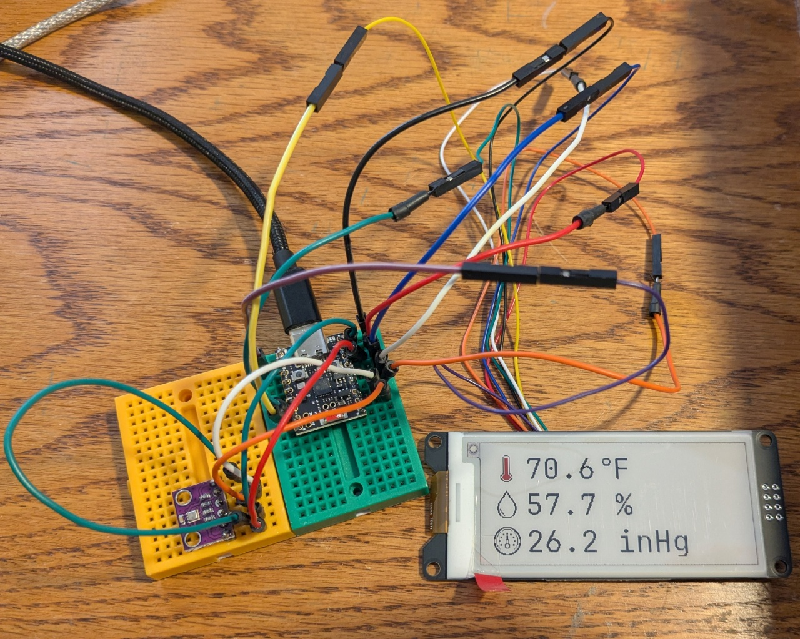
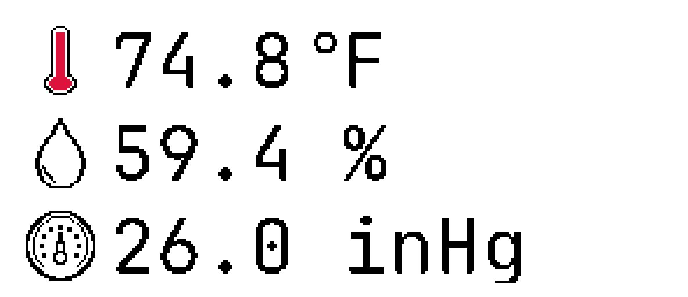

# REM — Room Environmental Monitor

A standalone environmental monitoring project built around the ESP32-H2, Bosch BME280 sensor, and a 2.9-inch, three-color e-paper display.

REM measures and displays ambient temperature, relative humidity, and atmospheric pressure. It also calculates additional environmental metrics, including dew point, which can be displayed through alternative layouts.

The project is designed as an inexpensive DIY embedded device, with an emphasis on reliable operation, efficient hardware utilization, and clear presentation of environmental data.


*Photo of working system [Full size image is here](./documentation/working_system.jpg).*

## Project Overview

REM is an embedded engineering project developed using native ESP-IDF and C. It combines environmental sensing, sensor data processing, custom display rendering, and low-level hardware integration into a standalone device.

The project incorporates several aspects of embedded systems development, including:

- Microcontroller programming using native ESP-IDF.
- Modular embedded C architecture.
- I²C communication and environmental sensor integration.
- SPI communication and e-paper display control.
- Custom bitmap fonts and graphics rendering.
- Temperature, humidity, pressure, and dew point calculations.
- Hardware initialization, error handling, and diagnostic output.
- Hardware-independent functionality suitable for unit testing.
- Hardware documentation and reproducible build configuration.

The goal is to develop a complete, understandable, and reproducible embedded system rather than simply display sensor readings.

## Hardware

The current implementation uses the following components. Supplier and total purchase price (including tax and shipping) are listed for each component.

| Component | Description | Supplier | Price |
|---|---|---|---:|
| Microcontroller | ESP32-H2 Super Mini development board | AliExpress | $5.49 |
| Environmental sensor | Bosch BME280 temperature, humidity, and pressure sensor module | AliExpress | $3.94 |
| Display | WeAct 2.9-inch, 296 × 128, three-color e-paper module (SSD1680 controller) | AliExpress | $12.12 |
| **Total** | | | **$21.55** |

The ESP32-H2 provides the processing and peripheral interfaces required by the project. The BME280 communicates over I²C, while the e-paper display uses SPI.

### Hardware Interfaces

**WeAct e-paper display**

| Display pin | ESP32-H2 GPIO | Physical access | Purpose |
|---|---|---|---|
| SCL (SCLK) | GPIO4 | Header | SPI clock |
| SDA (DIN MOSI) | GPIO5 | Header | SPI data |
| CS | GPIO14 | Header | Chip select |
| D/C | GPIO13 | Header | Data/command selection |
| RES / RST | GPIO12 | Header | Display reset |
| BUSY | GPIO23 | Header | Display busy status |
| VCC | 3V3 | Header | 3.3 V power |
| GND | GND | Header | Common ground |

**I²C — BME280**

- SDA: GPIO11
- SCL: GPIO10
- Bus frequency: 100 kHz

**SPI — E-paper display**

- SCLK: GPIO4
- MOSI: GPIO5
- CS: GPIO14
- D/C: GPIO13
- RESET: GPIO12
- BUSY: GPIO23
- Bus frequency: 4 MHz

Additional hardware details:

- Onboard status LED: GPIO13, shared with the display D/C signal.
- Button: GPIO0.
- USB Serial/JTAG provides the diagnostic interface; UART0 is not used for diagnostics.
- GPIO12 and GPIO14 are assigned to the display and are not available as independent auxiliary connections.

## Software Architecture

The firmware is organized into separate modules to keep hardware interfaces, sensor acquisition, calculations, and display rendering independent where practical.

The architecture is intended to make individual components easier to understand, test, maintain, and potentially reuse.

Key areas include:

- Sensor acquisition and environmental measurements.
- Temperature conversion and unit handling.
- Atmospheric pressure conversion.
- Dew point calculation.
- E-paper initialization and refresh management.
- Bitmap font and custom icon rendering.
- Main application control and diagnostics.

The display implementation uses custom graphics and bitmap fonts rather than relying exclusively on a conventional text-rendering library.

## Display

REM uses a 2.9-inch, 296 × 128-pixel, black/white/red e-paper display.

The display driver handles initialization, SPI communication, framebuffer management, and refresh operations.

Custom rendering routines support:

- Bitmap fonts in multiple sizes.
- Custom graphical icons.
- Black and red foreground graphics.
- Pixel-level drawing.
- Text and graphic positioning.

The display layout is designed around readability and efficient use of the available resolution. Alternative fonts, icons, units, and layouts can be incorporated without changing the underlying sensor acquisition.



*Current REM display layout.*

## Environmental Measurements

The BME280 provides the primary environmental measurements:

- **Temperature:** Ambient temperature.
- **Relative humidity:** Percentage of relative humidity.
- **Atmospheric pressure:** Barometric pressure.

Additional environmental metrics are calculated in firmware:

- **Dew point:** Calculated from temperature and relative humidity.

Temperature and pressure values can be converted into commonly used engineering units.

The current display layout presents temperature, relative humidity, and atmospheric pressure. Other calculated values and unit formats can be incorporated through alternative display layouts. For example, dew point, Celsius temperature, or pressure in hectopascals (hPa) can be displayed without requiring changes to the sensor hardware.

## Development Environment

REM is developed using:

- ESP-IDF 6.0.2
- Embedded C
- CMake-based ESP-IDF build system
- ESP32-H2 toolchain

The project uses the native ESP-IDF framework rather than Arduino abstractions.

## Testing

Hardware-independent functionality is separated from peripheral-dependent code where practical, facilitating host-side unit testing. All host-side Unity unit tests reside in the `test/` directory. The test suite includes both *happy-path* and *edge-case* tests.

To run the unit tests:

```bash
cd REM/test
make
```

## Project Scope and Limitations

REM is intended to operate as a standalone environmental monitor.

The initial implementation focuses exclusively on local sensing, processing, and display functionality.

The following are outside the scope of the project:

- **Wireless communication:** No wireless transmission or reception. The ESP32-H2's Bluetooth and 802.15.4 radio capabilities are not used.
- **Data storage:** No persistent storage of measurements or historical readings in nonvolatile memory.
- **Power management:** No deep-sleep implementation or other power-optimization strategy.
- **Battery operation:** The device is designed for continuous operation from a 5 V power supply, not battery power.
- **Measurement accuracy:** REM is not a laboratory-grade measurement instrument. Sensor readings are intended for general environmental monitoring, not precision measurement.

REM is a DIY project provided without guarantees of accuracy, reliability, or suitability for any particular application. It is provided without warranty or ongoing support.

The hardware and firmware architecture leave room for future experimentation, but additional functionality is not a dependency of the core application.

## License

This project is released under the MIT License. See [LICENSE](LICENSE) for details.

## Acknowledgments

- Espressif Systems for ESP-IDF and the ESP32-H2 platform.
- Bosch Sensortec for the BME280 sensor and associated documentation.
- WeAct Studio for the e-paper display hardware.